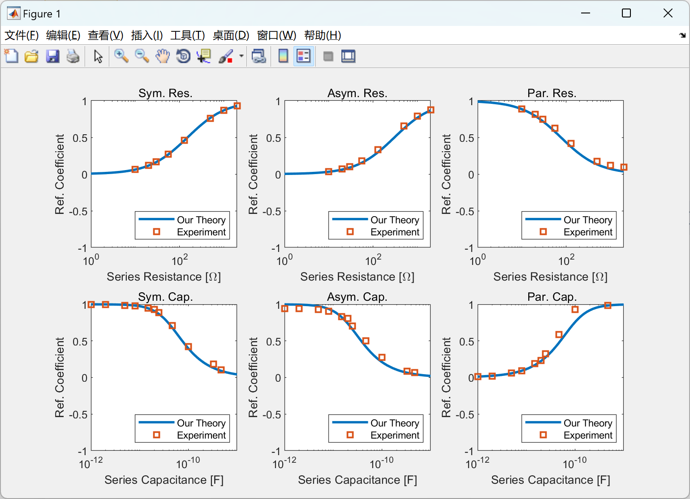
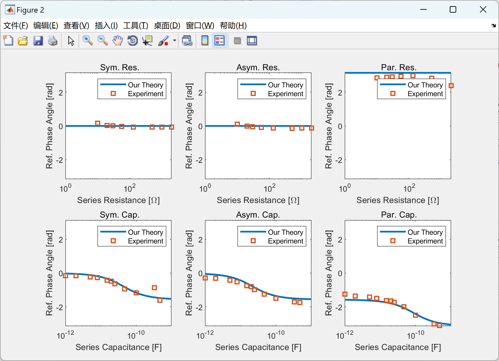
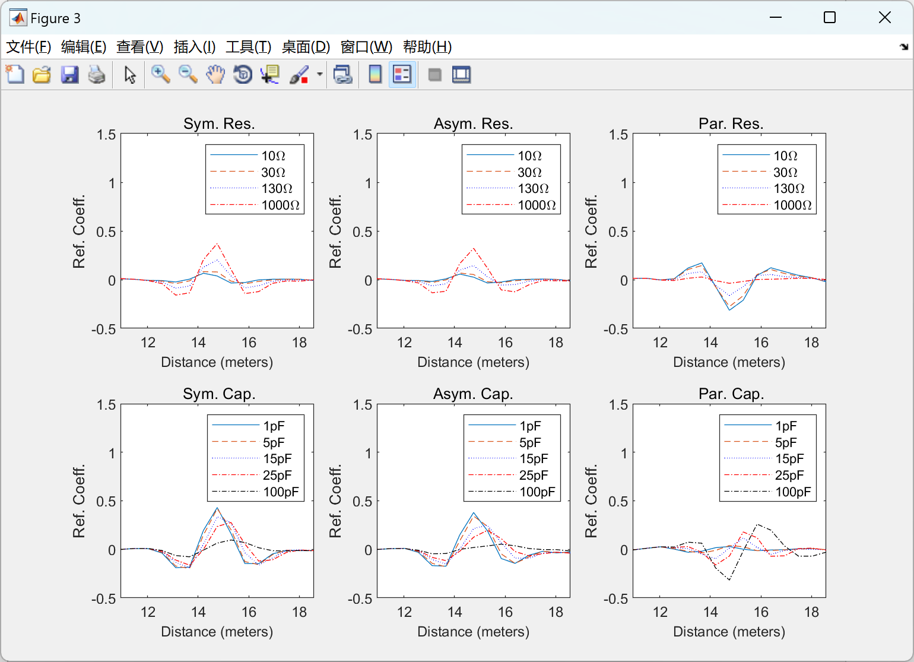

# [Transmission Line Open and Short Circuit Faults]Non-Symmetric Transmission Line Expanded Frequency Domain Reflectometry with Collection Elements (Matlab Code Implementation)

[Transmission Line Open and Short Circuit Faults]Non-Symmetric Transmission Line Expanded Frequency Domain Reflectometry with Collection Elements (Matlab Code Implementation)
\n        \n      \n        \n      \n        \n  

## Images

<!-- PAYMENT_BLOCK -->

## Get this dataset

- Payment link (Stripe): [Buy now](https://buy.stripe.com/3cs8yP7sY87d0vu9AB)
- Payment QR code: 

<!-- /PAYMENT_BLOCK -->
